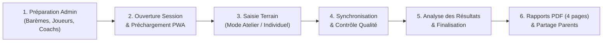

# Guide Opérationnel Complet — FUTURISTE ASSESSMENT
**FUTURISTE ACADÉMIE FC • Plateforme d'évaluation, d'analyse et de reporting sportif**

> [!IMPORTANT]
> Ce manuel couvre l'intégralité du parcours opérationnel de l'application **FUTURISTE ASSESSMENT**, depuis la configuration initiale avant le jour du test jusqu'à la saisie au bord du terrain (avec ou sans connexion internet), l'analyse des profils sportifs et la remise des rapports PDF individuels aux parents.

---

## 1. Vue d'ensemble du fonctionnement

**FUTURISTE ASSESSMENT** organise chaque journée d'évaluation autour de **6 étapes structurées** :

### Deux rôles distincts et sécurisés

| Rôle | Qui ? | Droits réels (appliqués côté serveur et en base PostgreSQL) |
| --- | --- | --- |
| **`ADMIN`** | Direction technique, coordinateurs administratifs | Accès complet : création des comptes encadreurs, import/gestion des joueurs et parents, configuration des ateliers et des barèmes, ouverture/finalisation des sessions, lecture des classements, génération/téléchargement des PDF et exports CSV/ZIP. |
| **`COACH`** | Éducateurs et encadreurs sur le terrain | Accès ciblé : consultation uniquement des sessions, catégories et joueurs qui leur sont affectés ; saisie des performances et observations tant que la session est **« En cours »** ; aucun accès aux coordonnées téléphoniques des parents ni aux rapports PDF globaux. |

> [!NOTE]
> Les parents ne disposent pas de compte sur la plateforme (V1) : aucun parent ne peut voir le classement interne ni les notes d'un autre enfant. Chaque famille reçoit uniquement le **rapport PDF individuel (4 pages)** de son enfant.

---

## 2. Étape 1 — Préparer l'évaluation (Administrateur)

Avant le début du test (par exemple la veille du **Test d'Aptitude du 28 novembre 2026 à l'École Publique de Japoma, 9h30**), l'administrateur effectue **4 vérifications** :

### 2.1 Créer les comptes de l'équipe (`/encadreurs`)
1. Ouvrez le menu **Comptes & Encadreurs**.
2. Cliquez sur **Créer un compte encadreur**.
3. Renseignez le nom complet, l'email, le téléphone, choisissez le rôle **`COACH`** (éducateur terrain) ou **`ADMIN`** (co-responsable) et définissez un mot de passe initial d'au moins 8 caractères.
4. Transmettez à chaque membre l'adresse `/connexion` et ses identifiants personnels.

### 2.2 Paramétrer les seuils des barèmes (`/baremes`)
L'application intègre nativement les **12 ateliers officiels sur 100 points** répartis en **5 domaines** :

| Domaine | Code & Atelier | Points max | Mode d'évaluation initial |
| --- | --- | --- | --- |
| **Compétences athlétiques (/40)** | `A1` — Sprint (10m / 20m / 30m) | **10 pts** | 2 essais (meilleur temps retenu) — *Seuils à définir par catégorie* |
| | `A2` — Agilité (parcours zigzag) | **10 pts** | Temps (`/6`, 2 essais) + Qualité changements de direction (`/4`) |
| | `A3` — Coordination (échelle) | **8 pts** | Vitesse d'exécution (`/4`) + Précision & fluidité (`/4`) |
| | `A4` — Réaction au signal | **6 pts** | Rapidité de réaction (`/3`) + Essais réussis sur 4 (`/3`, auto) |
| | `A5` — Explosivité (saut sans élan) | **6 pts** | Meilleure distance sur 2 essais (`/4`) + Technique & réception (`/2`) |
| **Compétences techniques (/30)** | `T1` — Passes (sur 10 passes) | **8 pts** | Passes réussies `/10` (`/5`, auto) + Qualité de transmission (`/3`) |
| | `T2` — Contrôle orienté (8 rép.) | **6 pts** | Qualité de l'amorti (`/4`) + Orientation 1re touche (`/2`) |
| | `T3` — Conduite et dribble (slalom) | **8 pts** | Meilleur temps sur 2 essais (`/4`) + Maîtrise des 2 pieds (`/4`) |
| | `T4` — Finition (sur 8 tirs) | **8 pts** | Tirs cadrés `/8` (`/5`, auto) + Qualité de frappe (`/3`) |
| **Capacités physiques (/10)** | `P1` — Endurance (navettes 3/4/5 min) | **10 pts** | Nombre de navettes (`/6`) + Rythme (`/2`) + Qualité déplacement (`/2`) |
| **Intelligence de jeu (/15)** | `I1` — Mini-matchs | **15 pts** | 5 critères qualitatifs sur 3 pts (Prise d'info, Décision, Placement, Compréhension off/déf, Anticipation) |
| **Esprit d'équipe (/5)** | `E1` — Esprit d'équipe | **5 pts** | 5 critères comportementaux observés sur 1 pt (`0` / `0,5` / `1`) |

> [!WARNING]
> **Pourquoi définir les seuils dans `/baremes` avant la validation ?**
> Conformément aux règles métier du club, le logiciel **n'invente aucun seuil chronométré universel**. Pour `A1`, `A2`, `A3`, `A5`, `T3` et `P1`, rendez-vous dans **Ateliers & Barèmes**, choisissez la catégorie (`U6–U9`, `U10–U13` ou `U14–U16`), passez le mode de barème sur **« Seuils / Paliers de référence »** (ou **« Interpolation linéaire »**), saisissez vos paliers, testez une valeur dans le simulateur intégré puis cliquez sur **« Publier et activer cette nouvelle version »**.

### 2.3 Enregistrer ou importer les joueurs (`/joueurs` et `/joueurs/importer`)
Deux méthodes sont possibles :
- **Ajout manuel** : dans **Joueurs → Nouveau joueur**, renseignez l'identité, la date de naissance (la catégorie est suggérée automatiquement), le poste préféré, le pied dominant, le(s) responsable(s) légal(aux) (téléphone, WhatsApp, email) et cochez le **consentement parental**. Un numéro unique `FA-0001` est attribué automatiquement.
- **Import en masse CSV ou Excel (`.xlsx`)** :
  1. Allez dans **Joueurs → Importer CSV / Excel**.
  2. Cliquez sur **Télécharger le modèle CSV** (`modele_import_joueurs_FAFC.csv`).
  3. Remplissez votre liste dans Excel (dates acceptées : `14/05/2015` ou `2015-05-14`).
  4. Chargez le fichier : vérifiez la correspondance des colonnes et le tableau de prévisualisation (les lignes erronées ou en doublon sont signalées et téléchargeables en rapport d'erreurs).
  5. Cliquez sur **Confirmer l'import**.

### 2.4 Configurer et ouvrir la session (`/sessions`)
1. Ouvrez **Sessions** et cliquez sur la session prévue (ex. *Test d'aptitude FUTURISTE ACADÉMIE FC - Saison 2026-2027*).
2. **Inscrire les joueurs** : cliquez sur **« Inscrire tous les joueurs actifs des catégories »** (ou inscrivez joueur par joueur avec son numéro de **dossard**).
   *Important : le système fige automatiquement la catégorie et calcule l'âge exact du joueur à la date précise de la session, jamais à la date où vous consulterez la fiche des mois plus tard.*
3. **Affecter les encadreurs** : dans le panneau de droite, sélectionnez chaque éducateur et affectez-le soit à un atelier précis (ex. *Coach Marc → `A1 Sprint` → `U10–U13`*), soit à tous les ateliers.
4. **Démarrer la session** : cliquez sur le bouton vert **Passer « En cours »**. Dès cet instant, la saisie est ouverte aux éducateurs sur le terrain.

---

## 3. Étape 2 — Préparer les téléphones / tablettes pour le terrain (Mode Hors Ligne PWA)

Sur un terrain de football où la couverture mobile peut être instable :

1. **Installer l'application sur l'écran d'accueil** :
   - **iPhone / iPad (Safari)** : appuyez sur **Partager** → **Sur l'écran d'accueil**.
   - **Android (Chrome)** : appuyez sur le menu **`⋮`** → **Installer l'application**.
2. **Précharger la session avant le coup d'envoi** (avec Wi-Fi ou 4G active) :
   - Ouvrez le menu **Mode hors ligne & Sync** (`/synchronisation`) — ou la fiche de la session — et appuyez sur **« Précharger pour hors ligne »**.
   - Les joueurs, dossards, ateliers, consignes et barèmes sont copiés dans la mémoire sécurisée de l'appareil (`IndexedDB`).

---

## 4. Étape 3 — Réaliser les tests et saisir sur le terrain (`/terrain`)

Au bord du terrain, l'encadreur ouvre **Saisie terrain** (`/terrain`). Deux modes complémentaires sont proposés en haut de l'écran :

### Mode A — « Mode Atelier » (recommandé par poste fixe)
Idéal lorsqu'un éducateur tient un atelier précis (ex. *Atelier `A1 Sprint`* ou *`T1 Passes`*) et voit défiler tout un groupe :
1. Sélectionnez **1. Session**, **2. Atelier**, **3. Catégorie** (`U6–U9`, `U10–U13` ou `U14–U16`).
2. Le bandeau bleu rappelle immédiatement le **protocole exact de la catégorie** (ex. *20 m — 2 tentatives — meilleur temps*).
3. Pour chaque joueur de la liste :
   - **Épreuve numérique (temps, distance, réussites, navettes)** : tapez l'Essai 1 puis l'Essai 2 dans les grands champs numériques ; dès que vous quittez le champ (ou appuyez sur **Valider**), le meilleur essai et le score sont calculés et sauvegardés automatiquement.
   - **Critère qualitatif (technique, mini-matchs, esprit d'équipe)** : appuyez directement sur la carte correspondant au niveau observé. **Chaque bouton affiche clairement la signification concrète de la note** afin d'harmoniser la notation entre éducateurs.
   - **Observation ou absence** : appuyez sur **« Obs. / Statut »** sur la ligne du joueur pour saisir une remarque factuelle ou marquer le joueur **Absent** / **Dispensé**.

### Mode B — « Mode Individuel » (suivi d'un joueur)
Idéal lors des mini-matchs (`I1`) ou pour compléter la fiche d'un joueur précis :
1. Basculez sur **Mode Individuel** en haut à droite.
2. Évaluez le joueur affiché, ajoutez votre observation, appuyez sur **Enregistrer la performance**, puis passez instantanément au suivant grâce au grand bouton **« Joueur suivant → »**.

### Comprendre les indicateurs de sauvegarde et de synchronisation
- **Badge vert `Synchronisé`** : la note est confirmée et enregistrée sur le serveur Supabase.
- **Badge orange `Local (en attente)`** : vous êtes hors ligne (ou réseau lent) ; la note est **protégée dans la mémoire du téléphone**, même si le navigateur est fermé. Dès le retour de la connexion, elle s'envoie automatiquement (ou en appuyant sur l'icône de synchronisation en haut de l'écran).
- **Badge rouge `Conflit`** : si deux encadreurs ont modifié le même test du même joueur en parallèle hors ligne, rendez-vous dans **Mode hors ligne & Sync** (`/synchronisation`) pour choisir en un clic entre **Conserver ma saisie locale** ou **Adopter la version serveur**.

---

## 5. Étape 4 — Lire, analyser et valider les résultats

Au fur et à mesure que les éducateurs saisissent les ateliers, l'administrateur suit l'avancement en direct :

1. **Tableau de bord (`/tableau-de-bord`)** :
   - Barre de progression globale de la session (nombre d'évaluations terminées sur le total attendu, joueurs en attente).
   - Moyenne globale de la session et radar moyen par domaine.
2. **Suivi des joueurs complets / incomplets (`/sessions/[id]`)** :
   - Filtrez la liste des participants sur **« Incomplets »** pour repérer immédiatement quel enfant n'est pas encore passé sur un atelier avant la fin de la matinée.
   - Lorsque tous les ateliers sont terminés, cliquez sur **« Clôturer la saisie (À valider) »** pour suspendre les modifications encadreurs pendant votre relecture.
3. **Lecture du profil individuel d'un joueur (`/joueurs/[id]`)** :
   Cliquez sur le nom d'un joueur pour ouvrir son bilan analytique complet :
   - **Score global `/100`** (et mention claire si l'évaluation est partielle).
   - **Profil(s) sportif(s) descriptif(s)** générés par règles objectives (*Profil athlétique*, *Profil technique*, *Profil créatif*, *Profil endurant*, *Profil collectif*, *Profil polyvalent*) — sans jamais figer un poste définitif ni prédire une carrière.
   - **Graphique Radar (normalisé sur 100)** et **Barres des 5 domaines** (`/40`, `/30`, `/10`, `/15`, `/5`).
   - **Tableau détaillé des 12 ateliers** (résultats bruts, tentatives, scores retenus et observations terrain).
   - **Points forts (`≥ 75 %`), axes de progression (`< 50 %`) et recommandations d'entraînement adaptées à sa catégorie d'âge**.
   - **Encadré Responsable Technique (Admin)** : rédigez si vous le souhaitez un **commentaire personnalisé de synthèse** (qui figurera en Page 4 du PDF), activez/désactivez l'analyse automatique, puis cliquez sur **« Valider l'évaluation du joueur »**.
   - **Historique multi-sessions** : dès qu'un joueur participe à plusieurs sessions, un comparateur d'évolution s'affiche en bas de page (avec blocage des écarts chiffrés si le joueur a changé de catégorie ou de version de barème entre les deux dates).
4. **Classement interne (`/classement`)** :
   - Filtrez par **Session**, **Catégorie** (toujours recommandé pour comparer des protocoles identiques) et **Domaine** (*Score global*, *Athlétique*, *Technique*, *Physique*, *Intelligence*, *Esprit d'équipe*).
   - Exportez le tableau en CSV en un clic si nécessaire.
5. **Finalisation officielle de la session (`/sessions/[id]`)** :
   - Cliquez sur **« Finaliser la session »**. Tous les scores consolidés sont figés. Toute correction ultérieure exigera un droit Administrateur et un **motif obligatoire** tracé dans le **Journal d'audit** (`/audit`).

---

## 6. Étape 5 — Générer, télécharger et transmettre les rapports PDF aux parents

Chaque rapport individuel est un document institutionnel de **4 pages A4 maximum** aux couleurs et avec le logo officiel de **FUTURISTE ACADÉMIE FC**, nommé automatiquement `FAFC_Rapport_Nom_Prenom_2026.pdf` :

- **Page 1** : En-tête officiel du club, saison, identité sportive du joueur, âge exact au jour du test, score global `/100`, interprétation indicative et note pédagogique aux parents.
- **Page 2** : Graphique radar vectoriel des 5 domaines, scores détaillés par domaine et résumé du profil sportif.
- **Page 3** : Tableau complet des 12 ateliers (résultats bruts, essais, scores `/max` et observations terrain exactes).
- **Page 4** : Points forts, axes d'amélioration prioritaires, recommandations d'entraînement adaptées à l'âge, appréciation de l'encadrement, visa de validation et date d'édition.

### Générer et télécharger les PDF (`/rapports` ou fiche joueur)
1. **Pour un seul joueur** : depuis `/joueurs/[id]`, cliquez sur **« Générer le rapport PDF »**, puis sur **« Aperçu »** (lecture directe dans un nouvel onglet) ou **« PDF »** (téléchargement).
2. **Pour toute la session en un clic** : ouvrez **Rapports PDF** (`/rapports`), sélectionnez la session et cliquez sur **« Générer toute la session »**.
3. **Tout télécharger d'un coup (Archive ZIP)** : dans `/rapports`, cliquez sur **« Exporter l'archive ZIP »** pour récupérer un dossier compressé contenant tous les rapports PDF individuels de la session.

> [!TIP]
> Si une note ou un commentaire est corrigé après génération d'un PDF, le rapport existant passe automatiquement au badge orange **« À regénérer »** pour vous éviter d'envoyer une version obsolète.

### Transmettre le rapport au parent ou responsable légal
Dans **Rapports PDF** (`/rapports`) ou sur la fiche du joueur, cliquez sur le bouton vert **« Transmettre »** (ou **« Partager au parent »**) :
1. Le **message officiel de transmission** de FUTURISTE ACADÉMIE FC est pré-rempli et personnalisable.
2. **Sur ordinateur** : cliquez sur **1. Télécharger le PDF**, puis sur **Préparer WhatsApp** (ouvre automatiquement la discussion WhatsApp au numéro du parent avec le texte prêt) ou **Préparer Email**, et glissez le fichier PDF téléchargé dans la conversation.
3. **Sur téléphone ou tablette** : cliquez sur **« Partage natif téléphone / tablette »** pour ouvrir le menu de partage d'iOS/Android avec le fichier PDF directement joint vers WhatsApp ou Mail.
